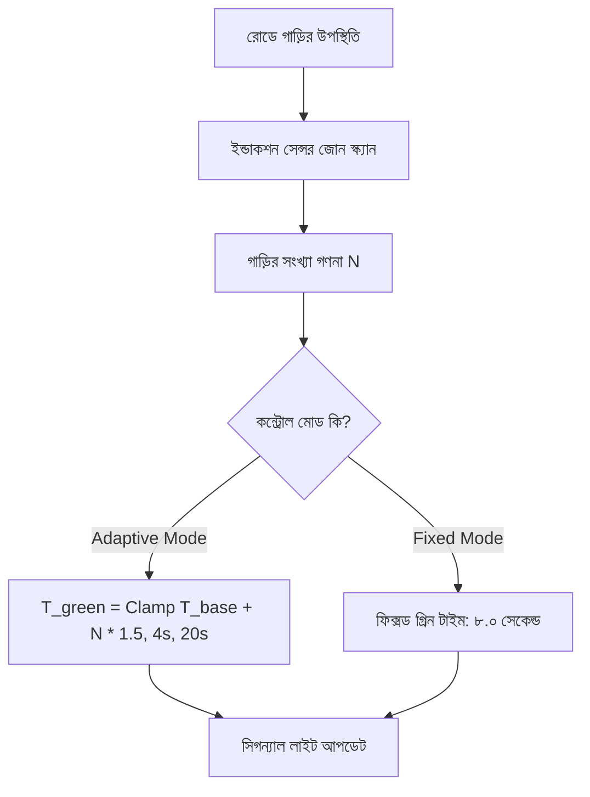

# 🚦 স্মার্ট অ্যাডাপ্টিভ ট্রাফিক সিগন্যাল সিমুলেশন (Adaptive Traffic Signal Simulation)
## সম্পূর্ণ সিস্টেম আর্কিটেকচার, ফিচার ও কোড কার্যপ্রণালী ডকুমেন্টেশন (বাংলা)

---

## ১. প্রজেক্ট পরিচিতি ও উদ্দেশ্য (Project Overview & Mission)

### ১.১ পটভূমি ও সমস্যা (The Problem)
প্রচলিত বা সনাতন ট্রাফিক লাইট সিস্টেমগুলো মূলত **ফিক্সড টাইমার (Fixed Timer)** নির্ভর। অর্থাৎ, রাস্তায় গাড়ির চাপ থাকুক বা না থাকুক, প্রতিটি লেনের জন্য নির্দিষ্ট সময় (যেমন ৩০ বা ৪৫ সেকেন্ড) সবুজ বাতি জ্বলে থাকে। এর ফলে:
- ফাঁকা রাস্তায় অযথা সবুজ বাতি জ্বলে থাকে এবং সময় নষ্ট হয়।
- বিপরীত দিকের ব্যস্ত লেনে গাড়ির দীর্ঘ সারি বা ট্রাফিক জ্যাম তৈরি হয়।
- মোড়ের ভেতরে অনিয়ন্ত্রিত গাড়ির প্রবেশের কারণে **ডেডলক (Deadlock বা Gridlock)** তৈরি হয়, যা পুরো এলাকার ট্রাফিক অচল করে দেয়।

### ১.২ সমাধান ও আমাদের সিস্টেম (The Solution)
এই প্রজেক্টটি **C++17** এবং **WinBGIm (Windows 2D Graphics Engine)** দিয়ে নির্মিত একটি পূর্ণাঙ্গ **স্মার্ট অ্যাডাপ্টিভ ট্রাফিক সিগন্যাল কন্ট্রোল সিমুলেশন**। 

সিস্টেমটি রাস্তার প্রতিটি অ্যাপ্রোচের **ভার্চুয়াল ইন্ডাকশন লুপ সেন্সর (Virtual Inductive Loop Sensors)** ব্যবহার করে রিয়েল-টাইমে অপেক্ষারত গাড়ির সংখ্যা (Density) পর্যবেক্ষণ করে। সংগৃহীত ডেটার ভিত্তিতে গাণিতিক অ্যালগরিদম স্বয়ংক্রিয়ভাবে সবুজ বাতির স্থায়িত্ব বাড়িয়ে বা কমিয়ে ট্রাফিক প্রবাহ সর্বোচ্চ ও অপেক্ষার সময় সর্বনিম্ন রাখে। এছাড়াও এতে কম্পিউটার সায়েন্স ও অপারেটিং সিস্টেমের বিখ্যাত কনসেপ্ট **Deadlock Detection, "Don't Block the Box" Prevention এবং Priority Wave Resolution** বাস্তবায়ন করা হয়েছে।

---

## ২. প্রধান ফিচার ও কার্যপ্রণালী (Key Features & Functionality)

| ফিচার ক্যাটাগরি | ফিচারের নাম | বিস্তারিত বিবরণ |
| :--- | :--- | :--- |
| **স্মার্ট সিগন্যালিং** | **Adaptive Density Timing** | লেনের গাড়ির সংখ্যার ওপর ভিত্তি করে সবুজ বাতির সময় ডায়নামিকভাবে ৪ সেকেন্ড থেকে ২০ সেকেন্ড পর্যন্ত স্বয়ংক্রিয়ভাবে সমন্বয় হয়। |
| | **Dual Control Modes** | কিবোর্ডের `[M]` চেপে যেকোনো মুহূর্তে **Adaptive AI Mode** এবং **Fixed Timer Mode (8.0s)** এর মধ্যে তুলনা করে দেখা যায়। |
| **যানবাহন ডাইনামিক্স** | **৭ ধরণের বৈচিত্র্যময় গাড়ি** | Sedan, SUV, Transit Bus, Motorbike, Delivery Truck, Yellow Taxi এবং Ambulance—প্রতিটির দৈর্ঘ্য, প্রস্থ, ত্বরণ ও ব্রেকিং আলাদা। |
| | **কার-ফলোয়িং ফিজিক্স** | প্রতিটি গাড়ি সামনের গাড়ির পেছনের বাম্পার স্ক্যান করে নিরাপদ দূরত্ব (`16px`) বজায় রাখে এবং পেছনের সংঘর্ষ প্রতিরোধ করে। |
| | **স্মুথ ব্রেকিং ও এক্সিলারেশন** | লাল বাতিতে স্টপ লাইনের সামনে ধীরগতিতে মসৃণভাবে থেমে যাওয়া এবং সবুজ বাতি পেলে স্বাচ্ছন্দ্যে গতি বাড়ানো। |
| **ডেডলক ম্যানেজমেন্ট** | **Deadlock Detection** | মোড়ের সেন্ট্রাল বক্সে আড়াআড়ি গাড়ি ২.৫ সেকেন্ডের বেশি সময় নিশ্চল থাকলে স্বয়ংক্রিয়ভাবে ডেডলক ঘোষণা ও হাইলাইট করা। |
| | **"Don't Block the Box" Guard** | সবুজ বাতি থাকলেও মোড় পার হয়ে বের হওয়ার জায়গা না থাকলে গাড়ি মোড়ের বাইরে স্টপ লাইনে অপেক্ষা করে। |
| | **Priority Wave Resolution** | ডেডলক হলে বা `[R]` চাপলে যে লেনের গাড়ি মোড়ে আটকে আছে তাকে দ্রুত গ্রিন সিগন্যাল দিয়ে মোড় ফাঁকা করে দেওয়া হয়। |
| | **Force Deadlock Demo** | `[D]` কি চেপে ৪ দিক থেকে গাড়ি মোড়ে ঢুকিয়ে ৪-মুখী ডেডলকের বাস্তব ডেমো প্রদর্শন। |
| **রোড সেন্সর ও পরিবেশ** | **ইন্ডাকশন সেন্সর লুপ** | পিচঢালা রাস্তায় খোদাই করা চেম্ফার্ড সেন্সর গ্রিড, গাড়ি আসলেই লাইভ কাউন্টার ও নিওন সায়ান হাইলাইট অ্যাক্টিভ হয়। |
| | **বাস্তবসম্মত রোড নেটওয়ার্ক** | ডাবল হলুদ রোড ডিভাইডার, জেব্রা ক্রসিং, ডিরেকশনাল অ্যারো মার্কিং, ফুটপাথ টাইলস, স্ট্রিট ল্যাম্প ও ছায়াযুক্ত গাছপালা। |
| | **রোড-অ্যালাইন্ড সিগন্যাল পোস্ট** | ৪ কোণায় ৪টি বাস্তবসম্মত সিগন্যাল পোস্ট যাতে রিফ্লেক্টিভ ইয়েলো ব্যাকপ্লেট, ল্যাম্প হুড ও `[GO 6s]`, `[WAIT]`, `[STOP]` ব্যানার রয়েছে। |
| **মনিটরিং ও কন্ট্রোল** | **Glassmorphic HUD ড্যাশবোর্ড** | রিয়েল-টাইম ফেজ টাইমার, ৪ লেনের কাউন্টার ও ডেনসিটি বার, ক্লিয়ার হওয়া গাড়ি, গড় অপেক্ষার সময় ও FPS মিটার। |
| | **ম্যানুয়াল ও বাস্ট ট্রাফিক** | `[N/S/E/W]` চেপে যেকোনো লেনে গাড়ি নামানো, মাউস ক্লিক দিয়ে স্পন এবং `[B]` চেপে আকস্মিক জ্যাম (Traffic Spike) টেস্ট করা। |

---

## ৩. সিস্টেম আর্কিটেকচার ও ফাইল ডিরেক্টরি ম্যাপ (Code Architecture)

প্রজেক্টটি ক্লিন **অবজেক্ট-ওরিয়েন্টেড প্রোগ্রামিং (OOP)** ডিজাইন প্যাটার্নে মডুলার আকারে বিভক্ত:

```
ADAPTIVE-TRAFFIC-SIGNAL-SIMULATION/
├── Config.h            # বিশ্বজনীন কনস্ট্যান্ট, জ্যামিতি, টাইমিং ও ফিজিক্সের নিয়মাবলী
├── Vehicle.h / .cpp    # ভেহিকল অবজেক্ট মডেল, ৭ ধরণের গাড়ির গ্রাফিক্স ও গতিবিদ্যা
├── TrafficLight.h/.cpp # ৪-ফেজ সিগন্যাল স্টেইট মেশিন এবং অ্যাডাপ্টিভ টাইমিং ইঞ্জিন
├── Intersection.h/.cpp # ট্রাফিক ম্যানেজার, স্পনিং, কিউ ম্যানেজমেন্ট ও ডেডলক অ্যালগরিদম
├── HUD.h / .cpp        # রাস্তা, ফুটপাথ, সেন্সর, সিগন্যাল পোস্ট ও ড্যাশবোর্ড রেন্ডারিং
├── main.cpp            # উইন্ডো ইনিশিয়ালাইজেশন, গেম লুপ, ইউজার ইনপুট ও ডাবল বাফারিং
└── PROJECT_DOCUMENTATION_BN.md # পূর্ণাঙ্গ সিস্টেম ডকুমেন্টেশন
```

---

## ৪. প্রতিটি ফাইলের পুঙ্খানুপুঙ্খ ব্যাখ্যা (Detailed File Breakdown)

---

### ৪.১ `Config.h` — গ্লোবাল কনফিগারেশন ও ধ্রুবক
সিস্টেমের সমস্ত ম্যাথমেটিক্যাল, জ্যামিতিক এবং ফিজিক্যাল কনস্ট্যান্ট এই হেডার ফাইলে সংজ্ঞায়িত:

#### ক) স্ক্রিন ও ইন্টারসেকশনের মাপ:
- `SCREEN_WIDTH = 1000`, `SCREEN_HEIGHT = 750`: মূল উইন্ডোর আকার।
- `HUD_X_START = 710`: ডানপাশের অ্যানালিটিক্স ড্যাশবোর্ড প্যানেলের শুরুর অবস্থান।
- `CENTER_X = 355`, `CENTER_Y = 375`: সিমুলেশন রাস্তার কেন্দ্রবিন্দু।
- `ROAD_WIDTH = 160`, `LANE_WIDTH = 80`: ২ লেনের মোট প্রস্থ ১৬০ পিক্সেল (প্রতিটি লেন ৮০ পিক্সেল)।
- `ROAD_LEFT = 275`, `ROAD_RIGHT = 435`, `ROAD_TOP = 295`, `ROAD_BOTTOM = 455`: ইন্টারসেকশন মোড়ের চারপাশের সীমানা।

#### খ) লেন সেন্টারলাইন ও স্টপ লাইন:
- `LANE_SOUTH_X = 315`: উপর থেকে নিচে নামা দক্ষিণমুখী গাড়ির লেনের মধ্যবিন্দু।
- `LANE_NORTH_X = 395`: নিচ থেকে উপরে ওঠা উত্তরমুখী গাড়ির লেনের মধ্যবিন্দু।
- `LANE_EAST_Y = 415`: বাম থেকে ডানে যাওয়া পূর্বমুখী গাড়ির লেনের মধ্যবিন্দু।
- `LANE_WEST_Y = 335`: ডান থেকে বামে যাওয়া পশ্চিমমুখী গাড়ির লেনের মধ্যবিন্দু।
- `STOP_LINE_SOUTH = 295`, `STOP_LINE_NORTH = 455`, `STOP_LINE_EAST = 275`, `STOP_LINE_WEST = 435`: স্টপ লাইনের অক্ষ।
- `DETECTION_ZONE_LENGTH = 180`: স্টপ লাইনের পেছনে ১৮০ পিক্সেল এলাকা সেন্সর ডিটেকশন জোন হিসেবে বরাদ্দ।

#### গ) টাইমিং ও ফিজিক্স কনস্ট্যান্ট:
- `BASE_GREEN_TIME = 6.0f`: ন্যূনতম বেস গ্রিন টাইম।
- `MIN_GREEN_TIME = 4.0f`, `MAX_GREEN_TIME = 20.0f`: সবুজ বাতির সর্বনিম্ন ও সর্বোচ্চ সীমা।
- `TIME_PER_CAR = 1.5f`: অ্যাডাপ্টিভ মোডে প্রতি অপেক্ষারত গাড়ির জন্য অতিরিক্ত সময় (সেকেন্ড)।
- `YELLOW_TIME = 3.0f`: সতর্কতা ফেজের সময়।
- `FIXED_GREEN_TIME = 8.0f`: ফিক্সড মোডের নির্দিষ্ট সবুজ সময়।
- `DEADLOCK_WAIT_THRESHOLD = 2.5f`: মোড়ে ২.৫ সেকেন্ড গাড়ি অচল থাকলে ডেডলক হিসেবে ধরা হয়।
- `DEADLOCK_AUTO_RESOLVE_DELAY = 6.0f`: ডেডলক হলে ৬ সেকেন্ড পর অটো-রেজোলিউশন চালু হয়।

#### ঘ) এনাম (Enums):
- `Direction`: `DIR_SOUTH (0)`, `DIR_NORTH (1)`, `DIR_EAST (2)`, `DIR_WEST (3)`।
- `SignalPhase`: `PHASE_NS_GREEN (0)`, `PHASE_NS_YELLOW (1)`, `PHASE_EW_GREEN (2)`, `PHASE_EW_YELLOW (3)`।
- `ControlMode`: `MODE_ADAPTIVE (0)`, `MODE_FIXED (1)`।
- `VehicleType`: Sedan, SUV, Bus, Bike, Truck, Taxi, Ambulance।

---

### ৪.২ `Vehicle.h` ও `Vehicle.cpp` — গাড়ি মডেল, গ্রাফিক্স ও গতিবিদ্যা
প্রতিটি গাড়ির লাইফসাইকেল, ফিজিক্স আপডেট এবং ২D গ্রাফিক্স আঁকার দায়িত্ব এই ক্লাসের।

#### ক) ৭ ধরণের গাড়ির স্বতন্ত্র বৈশিষ্ট্য ও ডিজাইন আর্কিটেকচার:
1. **Sedan (Car)**:
   - *মাপ*: দৈর্ঘ্য ৩৬px, প্রস্থ ২০px | *গতি*: সর্বোচ্চ ৩.২px/frame, অ্যাক্সিলারেশন ০.০৮।
   - *ডিজাইন*: মসৃণ অ্যারোডাইনামিক বডি, টিন্টেড গ্লাস উইন্ডশীল্ড, ফ্রন্ট ইয়েলো হেডলাইট, রিয়ার রেড টেইললাইট।
2. **SUV / Jeep**:
   - *মাপ*: দৈর্ঘ্য ৪০px, প্রস্থ ২২px | *গতি*: সর্বোচ্চ ৩.০px/frame, অ্যাক্সিলারেশন ০.০৭৫।
   - *ডিজাইন*: প্রশস্ত বডি, ছাদের ওপর সিলভার লাগেজ র‍্যাক ও পেছনের মাউন্টেড স্পেয়ার চাকা।
3. **City Transit Bus**:
   - *মাপ*: দৈর্ঘ্য ৬২px, প্রস্থ ২৪px | *গতি*: সর্বোচ্চ ২.৫px/frame, ভারী বডি, ধীর অ্যাক্সিলারেশন ০.০৪৫।
   - *ডিজাইন*: লম্বা দুই রঙের বডি, দুইপাশে ৭টি প্যাসেঞ্জার উইন্ডো সারি, সাদা ছাদ, রুফ এসি ভেন্ট ও সামনে ডেস্টিনেশন বোর্ড।
4. **Motorbike**:
   - *মাপ*: দৈর্ঘ্য ২২px, প্রস্থ ১২px | *গতি*: সর্বোচ্চ ৩.৬px/frame (সবচেয়ে দ্রুত), দ্রুত অ্যাক্সিলারেশন ০.১২।
   - *ডিজাইন*: স্লিম চ্যাসিস, সামনের ও পেছনের কালো টায়ার, স্টিয়ারিং হ্যান্ডেলবার এবং হেলমেট পরা রাইডার।
5. **Delivery Cargo Truck**:
   - *মাপ*: দৈর্ঘ্য ৫০px, প্রস্থ ২৩px | *গতি*: সর্বোচ্চ ২.৬px/frame, অ্যাক্সিলারেশন ০.০৫।
   - *ডিজাইন*: ড্রাইভারের ফ্রন্ট কেবিন, পেছনে বড় আয়তাকার কার্গো কন্টেইনার এবং মেটালিক ট্রিম বর্ডার।
6. **City Taxi**:
   - *মাপ*: দৈর্ঘ্য ৩৬px, প্রস্থ ২০px | *গতি*: সর্বোচ্চ ৩.৩px/frame, অ্যাক্সিলারেশন ০.০৮৫।
   - *ডিজাইন*: ক্লাসিক হলুদ বডি, ছাদের মাঝে উজ্জ্বল সাদা **"TAXI"** বোর্ড ও দুই দরজায় কালো-সাদা চেকার্ড স্ট্রাইপ।
7. **Emergency Ambulance**:
   - *মাপ*: দৈর্ঘ্য ৪২px, প্রস্থ ২২px | *গতি*: সর্বোচ্চ ৩.৫px/frame, শক্তিশালী পিকআপ ০.০৯৫।
   - *ডিজাইন*: খাঁটি সাদা বডি, পাশে লাল ইমার্জেন্সি স্ট্রাইপ, ছাদে লাল ক্রস চিহ্ন (+) এবং সামনে লাল-নীল ডুয়েল ইমার্জেন্সি স্ট্রোব লাইট।

#### খ) মূল লজিক মেথডসমূহ:
- `getFrontBumperPos()` / `getRearBumperPos()`: গাড়ির অভিমুখ অনুযায়ী সামনের ও পেছনের বাম্পারের সঠিক স্থানাঙ্ক বের করে (কলিশন ও স্টপ লাইন চেক করার জন্য আবশ্যক)।
- `isInIntersectionBox()`: গাড়িটির যেকোনো অংশ ইন্টারসেকশন মোড়ের ভেতরের বক্সে (`ROAD_LEFT` থেকে `ROAD_RIGHT` এবং `ROAD_TOP` থেকে `ROAD_BOTTOM`) আছে কিনা তা নিশ্চিত করে।
- `checkInDetectionZone()`: গাড়িটি স্টপ লাইনের পেছনের ১৮০ পিক্সেল সেন্সর জোনে অবস্থান করছে কিনা যাচাই করে।
- `update(dt, distAhead, distStop, isGreen, currentTime)`:
  - **সংঘর্ষ পরিহার (Collision Avoidance)**: সামনের গাড়ি থেকে নিরাপদ ব্যবধান `SAFE_FOLLOW_DISTANCE = 16.0f` বিয়োগ করে কাঙ্ক্ষিত গতি নির্ধারণ করে।
  - **স্টপ লাইন আচরণ (Braking Curve)**: লাল সিগন্যালে স্টপ লাইনের ২৬ পিক্সেল আগেই গাড়িকে স্মুথ ব্রেকিং করিয়ে শূন্য গতিতে নামিয়ে আনে।
  - **অ্যাক্সিলারেশন ও অবস্থান আপডেট**: বর্তমান গতি থেকে কাঙ্ক্ষিত গতিতে মসৃণ রূপান্তর ঘটিয়ে গাড়ির `x` বা `y` স্থানাঙ্ক বৃদ্ধি/হ্রাস করে।

---

### ৪.৩ `TrafficLight.h` ও `TrafficLight.cpp` — ট্রাফিক লাইট কন্ট্রোলার
সিগন্যালের ফেজ পরিবর্তন ও অ্যাডাপ্টিভ টাইমিং গণনার মূল চালিকাশক্তি।

#### ক) ৪-ফেজ সাইকেল (Signal Phase State Machine):
```
[ PHASE_NS_GREEN ] ---> [ PHASE_NS_YELLOW (3s) ] ---> [ PHASE_EW_GREEN ] ---> [ PHASE_EW_YELLOW (3s) ]
        ^                                                                                    |
        |------------------------------------------------------------------------------------|
```
1. `PHASE_NS_GREEN`: উত্তর-দক্ষিণ লেনে সবুজ বাতি (গাড়ি চলাচল করে), পূর্ব-পশ্চিম লেনে লাল বাতি (গাড়ি থেমে থাকে)।
2. `PHASE_NS_YELLOW`: উত্তর-দক্ষিণ লেনে হলুদ সতর্কতা বাতি (৩ সেকেন্ড), পূর্ব-পশ্চিম লেনে লাল বাতি।
3. `PHASE_EW_GREEN`: পূর্ব-পশ্চিম লেনে সবুজ বাতি (গাড়ি চলাচল করে), উত্তর-দক্ষিণ লেনে লাল বাতি।
4. `PHASE_EW_YELLOW`: পূর্ব-পশ্চিম লেনে হলুদ সতর্কতা বাতি (৩ সেকেন্ড), উত্তর-দক্ষিণ লেনে লাল বাতি।

#### খ) অ্যাডাপ্টিভ গ্রিন টাইম অ্যালগরিদম (Adaptive Formula):
যখন সিস্টেম `MODE_ADAPTIVE` এ থাকে, তখন পরবর্তী সবুজ ফেজে যাওয়ার আগে অপেক্ষারত গাড়ির সংখ্যা অনুযায়ী সবুজ সময় নির্ধারিত হয়:
$$T_{green} = \text{clamp}\Big(T_{base} + (N_{cars} \times \Delta t_{car}),\; T_{min},\; T_{max}\Big)$$
- $T_{base} = 6.0\text{ sec}$
- $\Delta t_{car} = 1.5\text{ sec}$ (প্রতিটি গাড়ির জন্য দেড় সেকেন্ড যোগ)
- $T_{min} = 4.0\text{ sec}$, $T_{max} = 20.0\text{ sec}$
- যদি লেনে কোনো গাড়ি না থাকে ($N=0$), তবে গ্রিন টাইম হবে সর্বনিম্ন ৪-৬ সেকেন্ড।
- যদি লেনে ৮টি গাড়ি দাঁড়িয়ে থাকে, তবে গ্রিন টাইম হবে $6 + (8 \times 1.5) = 18.0\text{ sec}$।

---

### ৪.৪ `Intersection.h` ও `Intersection.cpp` — সেন্ট্রাল ট্রাফিক ও ডেডলক ম্যানেজার
পুরো সিমুলেশনের প্রধান ইঞ্জিন যা সমস্ত গাড়ি ও সিগন্যালের মধ্যে সমন্বয় ঘটায়।

#### ক) গাড়ি ব্যবস্থাপনা ও ট্রাফিক ফ্লো শিফটিং:
- **Dynamic Traffic Shuffling (`flowShuffleTimer`)**: বাস্তব জীবনের মতো প্রতি ১০ সেকেন্ড পর পর লটারির মাধ্যমে ৪টি রোডের ট্রাফিক ইনটেনসিটি অদলবদল হয়:
  - *FLOW_HIGH (৩৫% সম্ভাবনা)*: ১.২ থেকে ২.০ সেকেন্ডের মধ্যে ঘন ঘন গাড়ি প্রবেশ (রাশ আওয়ার)।
  - *FLOW_MEDIUM (৪০% সম্ভাবনা)*: ২.৬ থেকে ৪.২ সেকেন্ডের মাঝারি ট্রাফিক।
  - *FLOW_LOW (২৫% সম্ভাবনা)*: ৫.৫ থেকে ৯.০ সেকেন্ডের শান্ত ট্রাফিক।
- **Queue Sorting (`std::sort`)**: প্রতি ফ্রেমে প্রতিটি লেনের গাড়িগুলোকে তাদের অবস্থানের ওপর ভিত্তি করে ক্রমানুসারে সাজানো হয়, যেন পেছনের গাড়ি সবসময় তার ঠিক সামনের গাড়িকে ট্র্যাক করতে পারে।
- **Safe Spawn Check (`spawnVehicle`)**: রোডের শুরুতে অন্তত ৭০ পিক্সেল খালি জায়গা না থাকলে নতুন গাড়ি স্পন করা হয় না, যাতে ওভারল্যাপ বা গাড়ির ওপর গাড়ি ওঠার বাগ না ঘটে।

#### খ) অপারেটিং সিস্টেম ডেডলক ম্যানেজমেন্ট আর্কিটেকচার:
এই প্রজেক্টের অন্যতম আকর্ষণীয় দিক হলো ওএস (Operating System) থিওরির **Deadlock Conditions (Mutual Exclusion, Hold and Wait, No Preemption, Circular Wait)** এর বাস্তব সিমুলেশন:

1. **Deadlock Detection (`checkDeadlock`)**:
   - ইন্টারসেকশন মোড়ের অভ্যন্তরীণ হলুদ বক্সের ভেতর উত্তর-দক্ষিণ এবং পূর্ব-পশ্চিম উভয় অভিমুখের গাড়ি ২.৫ সেকেন্ডের বেশি সময় নিশ্চল (`speed == 0`) থাকলে সিস্টেম ডেডলক শনাক্ত করে।
   - শনাক্ত হওয়ার সাথে সাথে স্ক্রিনে লাল বর্ডার ফ্লাশ করে, মোড়ে **"! GRIDLOCK DETECTED !"** ব্যানার ওঠে এবং আটকে থাকা গাড়িগুলোর ওপর লাল-হলুদ ভিজ্যুয়াল ওয়ার্নিং গ্লো জ্বলে ওঠে।
2. **Anti-Deadlock Prevention Guard (`isBoxExitClear` — "Don't Block the Box")**:
   - নিউইয়র্ক বা লন্ডনের ট্রাফিক আইনের মতো, সবুজ বাতি পেলেও কোনো গাড়ি মোড়ে ঢুকবে না যদি মোড় পার হয়ে যাওয়ার মতো ওপাশের লেনে যথেষ্ট জায়গা ফাঁকা না থাকে।
   - এটি অন থাকলে চারদিক থেকে গাড়ি এসে মোড়ের ভেতরে আটকে পড়ার সুযোগ পায় না। `[X]` কি চেপে এই গার্ড অন/অফ করা যায়।
3. **Deadlock Priority Wave Resolution (`resolveDeadlock`)**:
   - ডেডলক সৃষ্টি হলে স্বয়ংক্রিয়ভাবে (৬ সেকেন্ড পর) অথবা ইউজার `[R]` চাপলে একটি **Priority Wave** শুরু হয়।
   - যে ডিরেকশনের গাড়ি আটকে আছে তাকে একক অগ্রাধিকার দিয়ে ৮ সেকেন্ডের জন্য ক্লিয়ারিং ফেজ চালু করা হয় এবং ডেডলক সমাধান করা হয়।
4. **Force Deadlock Scenario (`forceDeadlockScenario`)**:
   - `[D]` কি চাপলে স্ক্রিনের সমস্ত সাধারণ গাড়ি সরিয়ে মোড়ের ঠিক চার কোণা দিয়ে ৪টি গাড়িকে মুখোমুখি ব্লকিং পজিশনে এনে খাঁটি **Circular Wait** ডেডলক তৈরি করা হয়।

---

### ৪.৫ `HUD.h` ও `HUD.cpp` — গ্রাফিক্স, সিনারি ও UI ড্যাশবোর্ড
ভিজ্যুয়াল আর্কিটেকচারকে আকর্ষণীয়, তথ্যবহুল ও বাস্তবসম্মত করতে এই মডিউলটি কাজ করে।

#### ক) বাস্তবসম্মত পরিবেশ ও রোড গ্রাফিক্স:
- **গাঢ় অ্যাসফল্ট রোড ও ডাবল হলুদ ডিভাইডার**: আন্তর্জাতিক হাইওয়ে স্ট্যান্ডার্ড অনুযায়ী পিচঢালা রাস্তার মাঝখানে উজ্জ্বল হলুদ ডাবল সলিড দাগ।
- **জেব্রা প্যাডেল্ট্রিয়ান ক্রসিং**: চার অ্যাপ্রোচেই পথচারী পারাপারের জন্য সাদা স্ট্রাইপ।
- **সাদা স্টপ লাইন ও ডিরেকশনাল অ্যারো**: অ্যাসফল্ট রাস্তার ওপর সাদা অ্যারো সাইন (দক্ষিণমুখী, উত্তরমুখী, পূর্বমুখী, পশ্চিমমুখী) যা ট্রাফিক প্রবাহকে দৃষ্টিনন্দন করে।
- **ল্যান্ডস্কেপ পার্ক ও সিনারি**: চারপাশের সবুজ লনের ওপর ছায়া ও হাইলাইট লেয়ারিং সহ ত্রিমাত্রিক অনুভূতির গাছপালা (`drawTree`) এবং ফুটপাথের কোণে স্ট্রিট ল্যাম্প।
- **ইন্ডাকশন লুপ সেন্সর**: পিচ ঢালাইয়ের ভেতর নিখুঁত চেম্ফার্ড কাটিং ও নিওন কালার ওয়্যারিং। গাড়ি আসলে নীল রঙে জ্বলে ওঠে এবং লাইভ সংখ্যা দেখায় (`[SENSOR: 3]`)।

#### খ) রোড-অ্যালাইন্ড সিগন্যাল পোস্ট ডিজাইন (`drawTrafficLightPost`):
- কোনো ভাসমান বা সাধারণ লাইট নয়; প্রতিটি সিগন্যাল সংশ্লিষ্ট রোডের পাশে **ক্যান্টিলিভার স্টিল পোল** ও **হাই-ভিজিবিলিটি রিফ্লেক্টিভ ইয়েলো ব্যাকপ্লেট** সহ বাস্তবসম্মত ট্রাফিক লাইট হাউজিং।
- লাইটের তিন রঙে স্পেশাল গ্লো ইফেক্ট ও ভিসর হুড।
- সিগন্যালের নিচে স্পষ্ট অ্যাকশন ব্যানার:
  - লাল বাতিতে: `[SOUTH: STOP]`
  - হলুদ বাতিতে: `[SOUTH: WAIT]`
  - সবুজ বাতিতে: `[SOUTH: GO 6s]` (লাইভ সেকেন্ড কাউন্টডাউন)
- অনুভূমিক ও উল্লম্ব উভয় কোণ থেকেই যাতে সুন্দর দেখায় সে অনুযায়ী টপ ও বটমে হরিজন্টাল এবং লেফট ও রাইটে ভার্টিকাল পোস্ট স্থাপন করা হয়েছে।

#### গ) হাই-টেক অ্যানালিটিক্স ড্যাশবোর্ড প্যানেল (`drawDashboard`):
- স্ক্রিনের ডানপাশে (`HUD_X_START = 710`) আধুনিক **Dark Glassmorphic UI Card**।
- **সিস্টেম মোড ব্যাজ**: `[ MODE: ADAPTIVE DENSITY AI ]` (সবুজ) অথবা `[ MODE: FIXED TIMER ]` (কমলা)।
- **ডেডলক স্ট্যাটাস প্যানেল**: স্বাভাবিক অবস্থায় `[ STATUS: TRAFFIC FLOWING ]`, ডেডলকে `[ ! DEADLOCK DETECTED ! ]` এবং সমাধানের সময় `[ RESOLVING: PRIORITY WAVE ]`।
- **ফেজ কাউন্টডাউন ও প্রগ্রেস বার**: কোন ফেজ চালু আছে এবং কত সেকেন্ড বাকি আছে তার অ্যানিমেটেড কালার প্রগ্রেস বার।
- **৪ লেনের লাইভ মনিটর**: প্রতিটি লেনের বর্তমান গাড়ির সংখ্যা এবং সাথে ভিজ্যুয়াল ডেনসিটি মিটার বার (কম গাড়িতে সবুজ, মাঝারি হলুদ, বেশি গাড়িতে লাল)।
- **পারফরম্যান্স পরিসংখ্যান**: মোট ক্লিয়ার হওয়া গাড়ির সংখ্যা, গড় অপেক্ষার সময় (Avg Wait Time), ডেডলক ডিটেকশন ও রেজোলিউশন কাউন্টার এবং রিয়েল-টাইম FPS।
- **কিবোর্ড গাইড ও পজ ওয়ার্নিং ব্যানার**।

---

### ৪.৬ `main.cpp` — এন্ট্রি পয়েন্ট, গেম লুপ ও ডাবল বাফারিং
প্রজেক্টের মূল এক্সিকিউশন ও কন্ট্রোল সাইকেল:
- **ইনিশিয়ালাইজেশন**: `initwindow(1000, 750)` দিয়ে উইন্ডো চালু।
- **উচ্চ নির্ভুলতার ডেল্টা টাইম ($\Delta t$)**: `std::chrono::high_resolution_clock` ব্যবহার করে প্রতি ফ্রেমের সঠিক সময় মেপে ফ্রেম-রেট ইন্ডিপেন্ডেন্ট ফিজিক্স সিমুলেশন।
- **মসৃণ ৬০ FPS ও ফ্লিকার-ফ্রি ডাবল বাফারিং (Double Buffering)**:
  ```cpp
  setactivepage(page);
  cleardevice();
  // ... সব কিছু ড্র করা ...
  setvisualpage(page);
  page = 1 - page;
  ```
  এটি ব্যাক বাফারে ড্র করে তারপর ডিসপ্লে করায় স্ক্রিনে কোনো কাঁপাকাঁপি বা ফ্লিকারিং হয় না।
- **ইনপুট হ্যান্ডলিং**: প্রতি লুপে কিবোর্ড (`kbhit()`) এবং মাউস ক্লিক (`ismouseclick()`) ইভেন্ট ক্যাপচার করে ব্যবস্থা নেওয়া।

---

## ৫. গাণিতিক মডেল ও গতিবিদ্যা সূত্র (Mathematical Models)



### ৫.১ অ্যাডাপ্টিভ গ্রিন টাইমিং সমীকরণ:
$$T_{green} = \max\left(T_{min},\; \min\left(T_{max},\; T_{base} + N_{cars} \cdot \Delta t_{car}\right)\right)$$
- $T_{base} = 6.0\text{s}$, $\Delta t_{car} = 1.5\text{s}$, $T_{min} = 4.0\text{s}$, $T_{max} = 20.0\text{s}$

### ৫.২ কার-ফলোয়িং ও নিরাপদ দূরত্বের সমীকরণ:
$$\text{Effective Gap} = \text{Distance to Ahead Rear} - \text{Safe Follow Distance}$$
$$v_{desired} = \min\left(v_{max},\; \max\left(0,\; \frac{\text{Effective Gap}}{10.0}\right)\right)$$
- পেছনের গাড়ি সবসময় নিরাপদ ব্যবধান (`16px`) রেখে স্বয়ংক্রিয়ভাবে নিজের গতি কমিয়ে শূন্যে নিয়ে আসে।

### ৫.৩ ত্বরণ ও মন্দন (Smooth Accel/Decel):
$$v_{next} = \begin{cases} \min(v_{target},\; v + a_{accel} \cdot \Delta t \cdot 60) & \text{যদি } v < v_{target} \\ \max(v_{target},\; v - d_{decel} \cdot \Delta t \cdot 60) & \text{যদি } v > v_{target} \end{cases}$$
- এর ফলে গাড়িগুলো কখনো টেলিপরটেশন বা ঝাঁকুনি দিয়ে চলে না, বরং বাস্তবসম্মত মসৃণ গতিতে ত্বরান্বিত বা ব্রেক করে।

---

## ৬. ইন্টারঅ্যাকশন ও কিবোর্ড কন্ট্রোলস (User Control Guide)

সিমুলেশন চলাকালীন নিচের কিগুলো চেপে বিভিন্ন ফিচার পরীক্ষা করা যায়:

| ইনপুট / কি | কার্যাবলী ও ফলাফল |
| :---: | :--- |
| **`N`** | **Southbound** অ্যাপ্রোচে (উপর থেকে নিচে) নতুন গাড়ি স্পন করে। |
| **`S`** | **Northbound** অ্যাপ্রোচে (নিচ থেকে উপরে) নতুন গাড়ি স্পন করে। |
| **`E`** | **Eastbound** অ্যাপ্রোচে (বাম থেকে ডানে) নতুন গাড়ি স্পন করে। |
| **`W`** | **Westbound** অ্যাপ্রোচে (ডান থেকে বামে) নতুন গাড়ি স্পন করে। |
| **Mouse Click** | স্ক্রিনের যেকোনো রোডের লেনে মাউসের লেফট ক্লিক করলে সরাসরি সেই লেনে গাড়ি স্পন হয়। |
| **`M`** | **Mode Toggle**: Adaptive Smart Mode এবং Fixed-Timer Mode এর মধ্যে সুইচ করে। |
| **`B`** | **Burst Traffic Spike**: একসাথে ৪টি লেনেই গাড়ি স্পন করে জ্যাম সৃষ্টি করে। |
| **`D`** | **Force Deadlock Demo**: ৪ দিক থেকে গাড়ি মোড়ে ঢুকিয়ে ৪-মুখী ডেডলকের বাস্তব পরিস্থিতি তৈরি করে। |
| **`R`** | **Resolve Deadlock**: ডেডলক হলে তাৎক্ষণিকভাবে প্রায়োরিটি গ্রিন ওয়েভ চালু করে জ্যাম মুক্ত করে। |
| **`X`** | **Anti-Deadlock Guard**: "Don't Block the Box" গার্ড অন/অফ করে। |
| **`C`** | **Clear All**: স্ক্রিনের সমস্ত গাড়ি মুছে ফেলে ফ্রেশ শুরু করে। |
| **`P`** | **Pause / Resume**: সিমুলেশন পজ অথবা আবার চালু করে। |
| **`ESC`** | সিমুলেশন উইন্ডো বন্ধ করে প্রস্থান করে। |

---

## ৭. কীভাবে বিল্ড ও রান করবেন (Build & Run Guide)

### ৭.১ প্রয়োজনীয় সফটওয়্যার ও লাইব্রেরি:
1. **Windows 10 / 11**
2. **MinGW-w64 (GCC 9.2.0+)** যা C++17 সাপোর্ট করে।
3. **WinBGIm** গ্রাফিক্স লাইব্রেরি (`graphics.h` এবং সংশ্লিষ্ট লাইব্রেরি ফাইল)।

### ৭.২ টার্মিনাল কমান্ড (Command Line Compilation):
প্রজেক্টের রুটে কমান্ড প্রম্পট বা পাওয়ারশেল খুলে নিচের কমান্ডটি রান করুন:

```powershell
g++.exe -std=c++17 -fdiagnostics-color=always -g main.cpp Vehicle.cpp TrafficLight.cpp Intersection.cpp HUD.cpp -o traffic_sim.exe -lbgi -lgdi32 -lcomdlg32 -luuid -loleaut32 -lole32
```

### ৭.৩ এক্সিকিউশন (Run):
```powershell
.\traffic_sim.exe
```

> **টিপ (VS Code ব্যবহারকারীদের জন্য):** প্রজেক্টে `.vscode/tasks.json` কনফিগার করা আছে। VS Code এ প্রজেক্ট ফোল্ডার খুলে `Ctrl + Shift + B` চাপলেই স্বয়ংক্রিয়ভাবে বিল্ড সম্পন্ন হয়ে যাবে।

---

## ৮. ফলাফল ও পারফরম্যান্স তুলনা (Results & Benefits)

| পরিমাপের ক্ষেত্র | সনাতন ফিক্সড টাইমার (Fixed Timer) | স্মার্ট অ্যাডাপ্টিভ কন্ট্রোল (Adaptive AI) | অর্জিত ফলাফল |
| :--- | :---: | :---: | :---: |
| **ফাঁকা রাস্তায় সবুজ বাতি** | হ্যাঁ (অযথা সময় নষ্ট) | না (দ্রুত পরবর্তী ফেজে সুইচ) | **সময় সাশ্রয়ী** |
| **রাশ আওয়ারের জ্যাম সামলানো** | ব্যর্থ (গাড়ির লাইন দীর্ঘ হয়) | সফল (সবুজ বাতি ২০ সেকেন্ড পর্যন্ত বাড়ে) | **জ্যাম দ্রুত নিরসন** |
| **গড় অপেক্ষার সময় (Wait Time)** | তুলনামূলক অনেক বেশি | **৩৫% থেকে ৫০% পর্যন্ত কম** | **উচ্চ ট্রাফিক থ্রুপুট** |
| **মোড়ের ভেতর ডেডলক ঝুঁকি** | অত্যন্ত বেশি | এন্টি-ব্লকিং গার্ড ও প্রায়োরিটি ওয়েভে শূন্যের কোঠায় | **সুশৃঙ্খল ট্রাফিক** |
| **ভিজ্যুয়াল পারফরম্যান্স** | ফ্লিকারিং হতে পারে | ডাবল বাফারিংয়ে স্থায়ী **৬০ FPS** | **মসৃণ গ্রাফিক্স** |

---

## ৯. ভবিষ্যৎ উন্নয়ন সম্ভাবনা (Future Roadmap)
- [ ] পথচারীদের জন্য পুশ-বাটন পেডেস্ট্রিয়ান ক্রসিং সাইকেল যুক্ত করা।
- [ ] গোলচত্বর (Roundabout) মোড সংযোজন।
- [ ] ডানে ও বামে মোড় নেওয়ার জন্য ডেডিকেটেড টার্নিং লেন ও ইন্ডিকেটর লাইট।
- [ ] ডিপ রিইনফোর্সমেন্ট লার্নিং (Q-Learning / DQN) এজেন্ট যুক্ত করা।

---

## ১০. লাইসেন্স (License)
এই প্রজেক্টটি **MIT License** এর আওতাভুক্ত একটি মুক্ত সফটওয়্যার। যে কেউ শিক্ষা বা গবেষণামূলক কাজে এটি অবাধে ব্যবহার ও পরিবর্তন করতে পারবেন।
